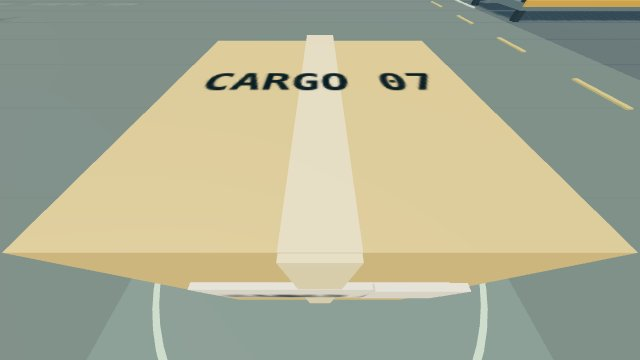

# GHOST · a fresh agent takes the controls

2026-10-18T02:33:58.108Z · actual independent Codex agent session

**Verified priority dispatch; inventory incomplete.** A fresh subagent used all four body types, inspected and staged Cargo 07, and reported an abrasion on Cargo 12. It inspected 2 of 3 tagged crates. Cargo 18 was not found. The agent explicitly declined to claim exhaustive coverage.

Only this 14 KB image loads by default. [Watch the real run at 4× speed — 92 seconds, 631 KB](agent-mission-4x.mp4?raw=true). The original session lasted 378 seconds, including observation waits and model/tool latency. The recording is continuous browser capture, sped up 4×.

- [Full console at the verified placement](step-016.jpg?raw=true)
- [Drone sensor image from the storage survey](frames/sensor-042-drone-01.jpg?raw=true)
- [Public MCP action/observation trace](trace.json)
- [Fresh-context instructions and agent's final report](agent-attestation.json)
- [Authority verification after the run](verification.json)

## What the agent knew

The user requested an agent without the parent chat or repository context. We started it with no inherited conversation and supplied only a general cargo-inspection/staging objective, the actual MCP schemas, and transport instructions. It was instructed to avoid source files, spectator state and snapshot APIs. No cargo coordinates, resource order, route, crate IDs or expected conditions were supplied in its mission prompt. The old canned mission route was removed from the MCP tool description first.

MCP discovery supplies body poses and capabilities. Leased observations supply sensor-limited cargo telemetry, coordinates, and optional camera images. This run used both telemetry and images; it is not a vision-only navigation benchmark. The agent reported directly viewing 9 sensor images. The parent evaluated final authority state after the agent finished to assess coverage and cleanup.

## What happened

The agent found Priority cargo 07, chose Scout for close inspection, and received **“Seal intact. Label verified. Cleared for dispatch.”** It selected Atlas, used reach/grasp/drop/place, and verified an empty gripper, completed placement, an arm camera image of the labelled crate over the floor marker, and independent camera telemetry at **[6, 0.55, 2]**. It returned the arm home.

A later camera sweep found Cargo 12. Its analytic inspection returned **“Surface abrasion on north face. Seal intact.”** The agent reported that exception and left the storage crate in place. The image does not simulate the abrasion texture; this finding came from the inspection tool.

The agent also chose Wisp for an aerial survey, viewed storage rows, and returned the drone to land. It found no further tagged cargo and explicitly reported incomplete coverage. Ground-truth verification found **Cargo 18 remained uninspected**. All remaining leases were released. There were 42 recorded MCP calls, excluding the helper's aggregated motion polls.

## A real failure, preserved

Two camera image deliveries, observations **18 and 33**, timed out in the recorder's spectator UI wait. MCP had produced those image files, but the agent did not receive/view them; it recovered with structured telemetry. Those server-captured files remain in the trace, and the attestation marks them unavailable to the agent. No camera observation success is inferred from those files.

The recorder was waiting for a camera image while the UI remained focused on another body. The committed fix focuses the observed body and preserves the actual MCP result even when presentation fails. A scripted regression test reproduces interleaved observations across two body leases. That regression test is separate from this independent-agent run.

## What is implemented

The session recorder forwards externally chosen MCP commands, keeps lease capabilities in memory, saves redacted results and exact JPEGs, polls movement when asked, and records the spectator UI. It contains no mission planner or route. In this run, the fresh Codex subagent supplied the decisions. It is not a standalone model runner or a one-click autonomous UI mode. No additional model key was required for this Codex session.

This demonstrates real agent control, body switching, rendered observations and verified cargo handling. Reliable whole-warehouse coverage remains future work. Manufact hosting and ChatGPT OAuth remain pending. [Run this with your own MCP agent](../../agent-missions.md).
