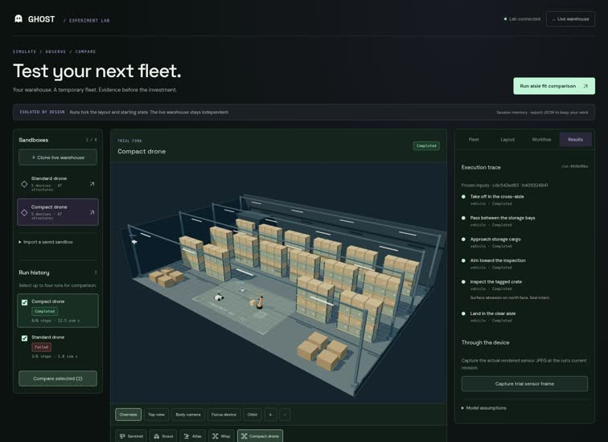
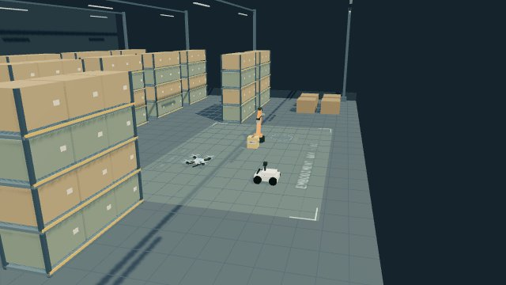

# GHOST · warehouse experiments

October 18, 2026 · Actual app captures and independently verified MCP trials.

Clone a warehouse, configure temporary device candidates, bind workflows, run isolated trials and compare evidence. Eleven experiment tools join the original five body tools. Open **Experiment lab** at /#lab.

[Continuous scripted UI demo, 2× — 202 KB](validation/experiment-lab-2x.mp4?raw=true) · [Full desktop](validation/lab-comparison-desktop.jpg) · [Phone preview](validation/lab-mobile-preview.jpg) · [Phone result](validation/lab-mobile-result.jpg)

## What works

- Clone live state or saved definitions; import/export versioned JSON. Drafts and trial forks stay isolated.
- Edit solid structures, temporary device placements, scale, speed, sensing and arm payload. Scale changes both rendered and checked geometry.
- Bind named actors to devices; author typed sequential workflows, dwell, budgets and safe endings.
- Watch real server state with orbit/pan/zoom, top view, device focus and body cameras. Capture actual trial sensor JPEGs.
- Preserve exact input revisions, step errors, metrics and assumptions. Cancel trials, release leases, retain reports and compare controlled variants.

## Scripted UI regression

The standard drone cannot pass a 2.4 m gap with its configured 2.9 m conservative envelope. The 70% scale candidate completes the same six-step inspection, lands, and releases leases. Both share scenario/workflow fingerprints. The failed run is retained and is never treated as a speed improvement.

[Comparison table](validation/comparison-table.jpg) · [Original blocked error](validation/lab-blocked-run.jpg) · [Device editor](validation/device-editor.jpg) · [Focus view](validation/device-focus.jpg) · [Workflow editor](validation/workflow-editor.jpg)

[Sensor image in UI](validation/trial-sensor-ui.jpg) · [Exported sandbox](validation/exported-sandbox.json) · [Browser/MCP assertions](validation/verification.json)

The recording uses scripted browser actions and real MCP SDK calls. It also verifies editing devices/layout preserves earlier reports, JSON download/import, phone workflow replay, no phone horizontal overflow and no browser errors. It is separate from the independent evaluation below.

## Independent agent-designed trial

A fresh context-free evaluator chose a temporary rover and its own 13-step, three-cargo inspection loop from disclosed operator scenario geometry. It received no route or expected outcome, used no starter template, and received no parent steering during control. It read actual MCP schemas, its own tool results and two returned JPEGs. This is an operator experiment, not a blind inventory benchmark.

| Candidate assumption | Result | Route | Simulated time |
| --- | --- | --- | --- |
| Rover at 1.8 m/s | 13/13 steps, 3 cargo inspected | 107.708 m | 65.838 s |
| Same rover at 3 m/s | 13/13 steps, 3 cargo inspected | 107.708 m | 41.903 s |

Only configured speed changed. Both ended safely with no failed/blocked steps and all leases released; 10/85 floor checkpoints were observed. Controlled comparison returned true. The 23.935 s difference is a sensitivity result under assumed speeds, not measured hardware performance.

The evaluator verified that editing the draft preserved the earlier run, then deleted its draft. After all decisions ended, the parent checked retained reports against exports, verified image hashes and confirmed the live warehouse remained untouched.

[Exact definitions, workflows and full reports](agent/independent-rover-trial.json) · [Original 12-call MCP trace](agent/trace.jsonl) · [Actual schemas](agent/schemas.json) · [Context/source attestation](agent/agent-attestation.json) · [Authority verification](agent/parent-verification.json)

[Agent-viewed sensor image 1](agent/sensor-1792335709439-e8627f.jpg)
[Agent-viewed sensor image 2](agent/sensor-1792335721117-646324.jpg)

There is no continuous video of the independent agent run. Its evidence is the original MCP trace, returned sensor images and authority-checked exports; the UI video above is scripted.

[Authenticated phone immersive view](validation/phone-immersive.jpg) · [Access and touch verification](validation/access-report.json). The mobile header and toolbar wrap to keep all actions on the visible screen. Real browser login, MCP inspection, ordinary Exit touch and logout passed.

## Current limits

Structures can be edited/imported inside the existing 64 × 44 m hall. Automatic CAD/photo reconstruction and arbitrary building footprints are not implemented. Device candidates are hypothetical uniform scales and bounded profiles, not calibrated vendor models.

Motion is kinematic with static solid obstacles and conservative swept clearance. No battery, acceleration/braking, airflow, radio, moving-device/cargo collision or real hardware calibration. Explicit dwell adds assumed task time; inspection and arm presets otherwise have no calibrated duration. Workflow execution is sequential typed commands, with no automatic planner or model provider.

Eight drafts, four active trials and the last 32 reports live in process memory; restart clears them. Export JSON for retention. This supports feasibility exploration and test design; physical safety and purchasing decisions require real hardware validation.

[Tool contracts and usage](../../experiment-lab.md) · [Earlier navigation evidence](../navigation/README.md) · [Earlier survey](../survey/README.md)
