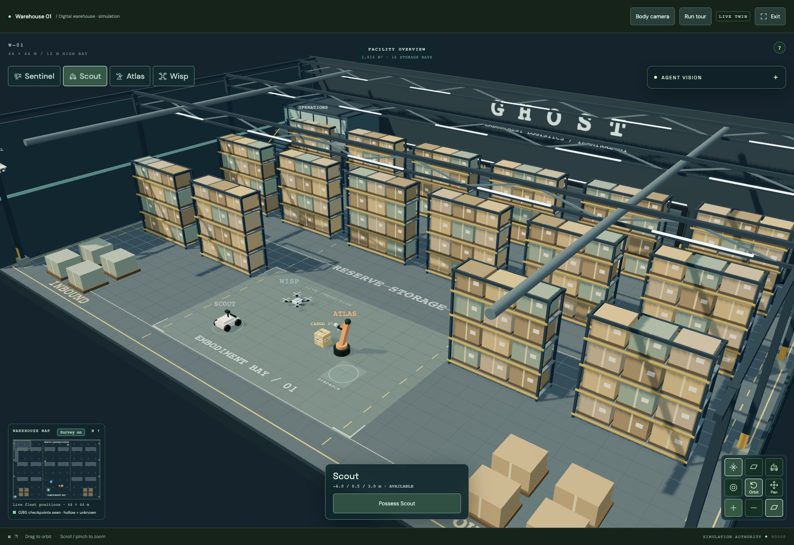
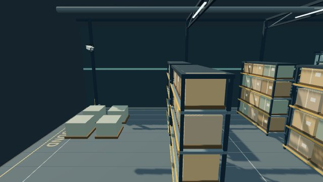

# GHOST · latest visual progress

[Rack tops: preserve the fourth storage tier and remove overlapping surfaces](../racks/README.md)

[Navigation realism: blocked routes, occluded sensing, drone gimbal and a fresh agent mission](../navigation/README.md)

[Short scripted navigation/gimbal recording — 102 KB](../navigation/validation/navigation-check-4x.mp4?raw=true). The report includes the independent agent recording, original MCP trace and remaining gaps.

Earlier: [Shared survey experiment](../survey/README.md) · [Initial incomplete agent run](../agent/README.md) · [MCP Apps and cameras](../vision/README.md).
