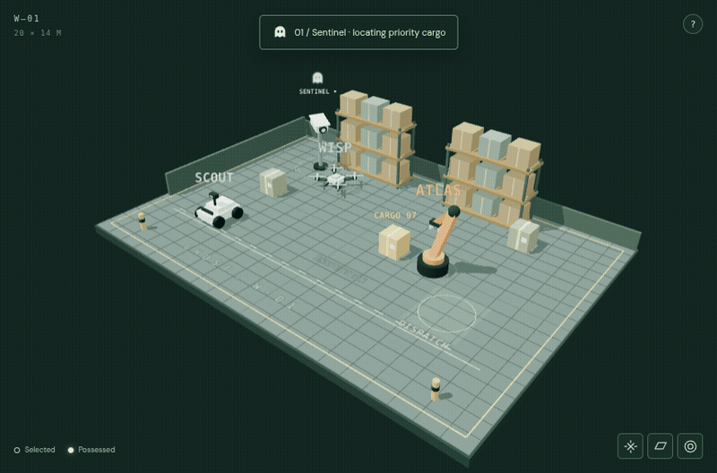
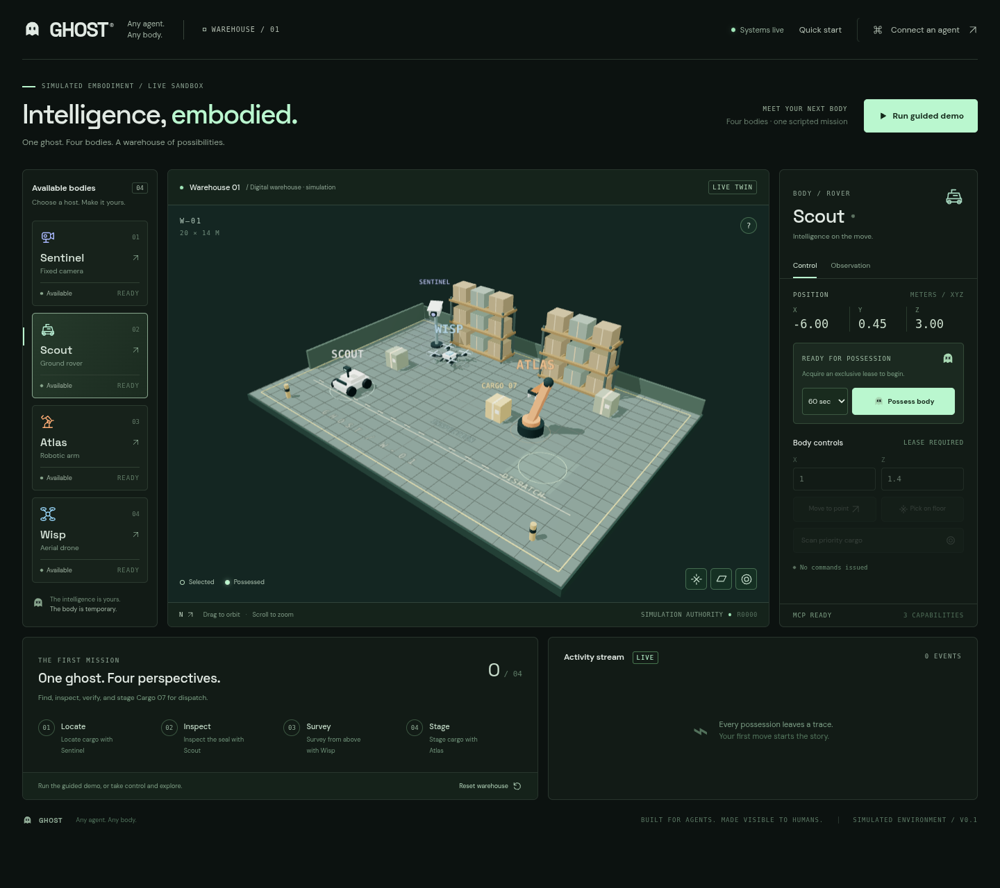
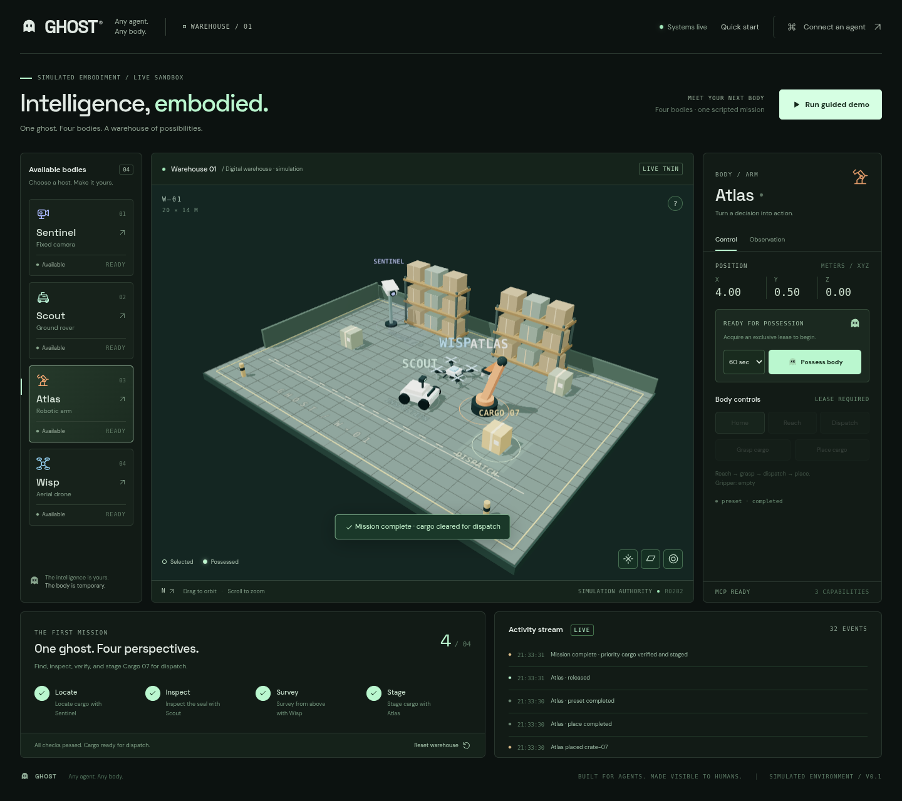
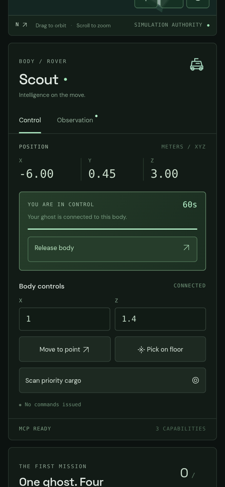
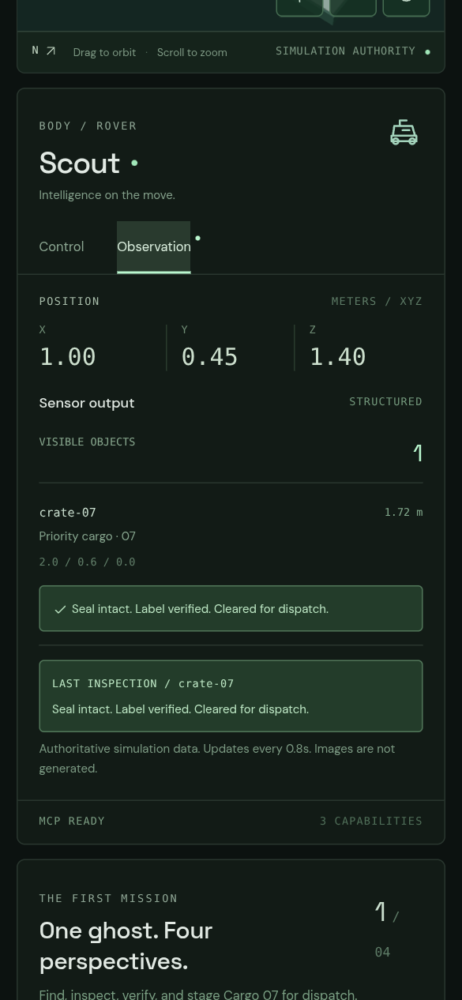
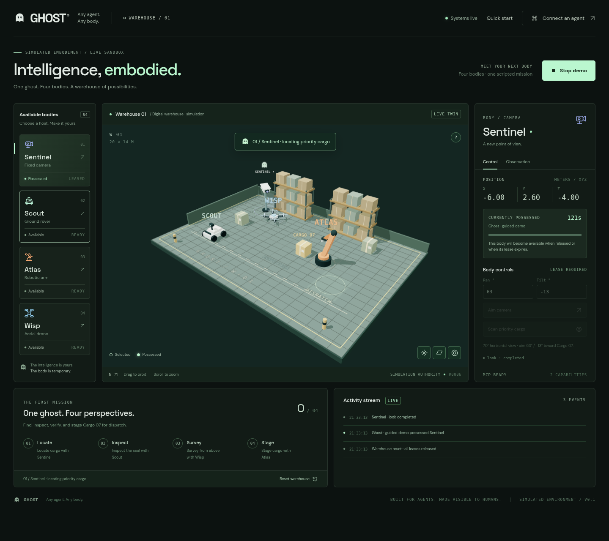
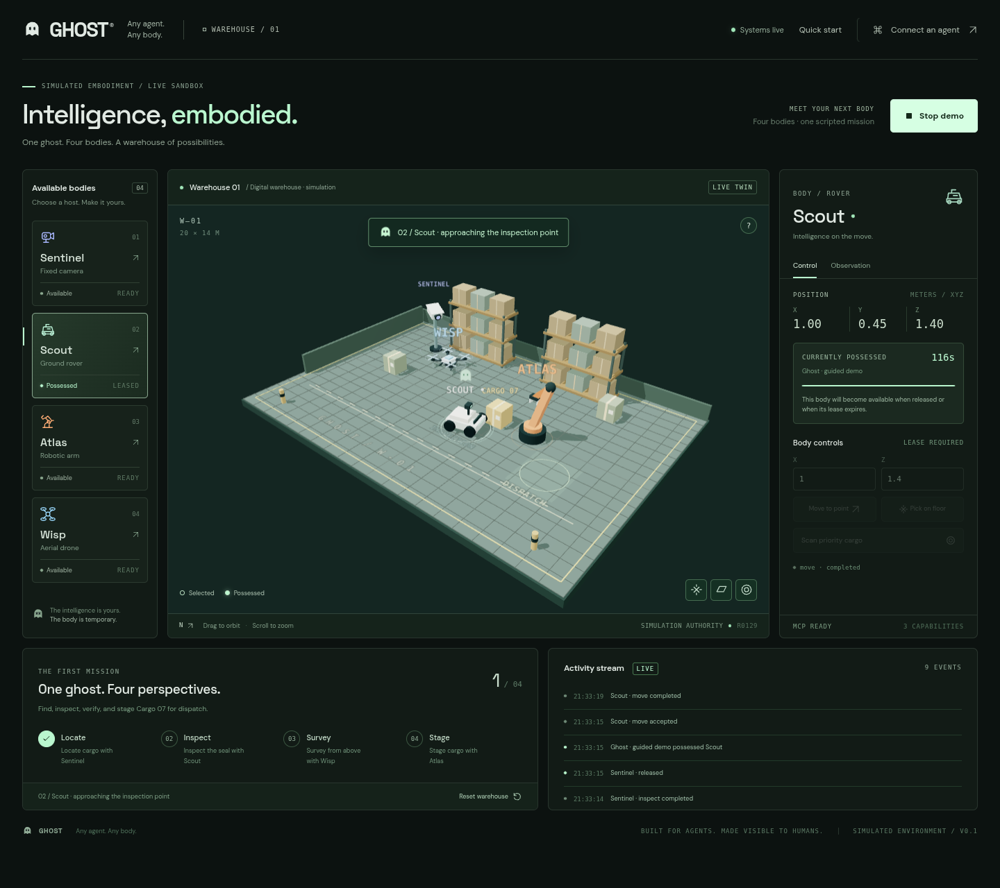
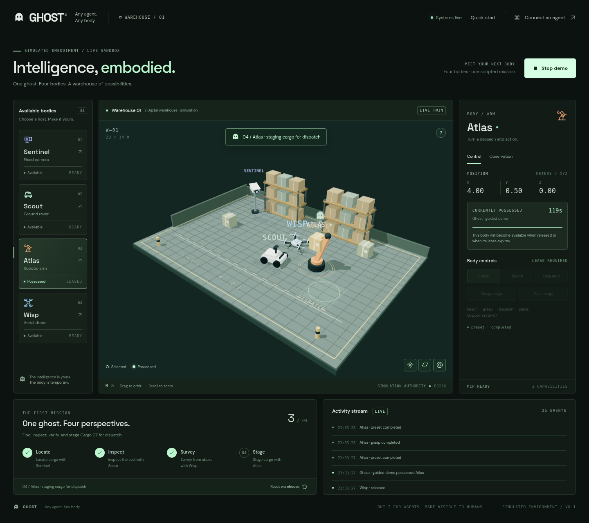
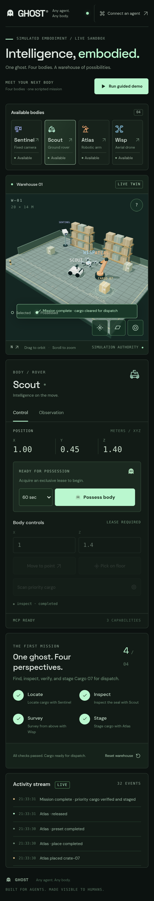

# GHOST · visual progress

Oct 17, 2026, 2:33 PM PT · actual app captures

**[Watch the complete 17-second mission](ghost-demo.mp4?raw=true)** · [Download MP4](ghost-demo.mp4?raw=true)

One ghost located Cargo 07 with Sentinel, inspected its seal with Scout, surveyed it with Wisp, and staged it for dispatch with Atlas. **4 / 4 steps passed; every lease was released.** This tour is scripted through the live control interface.

A separate phone-sized browser run possessed Scout, drove to the inspection point, scanned Cargo 07, and returned: **“Seal intact. Label verified. Cleared for dispatch.”** It then released the body. No browser runtime or console errors; no mobile horizontal overflow.

## Warehouse

## Mission complete

## Phone controls and observation

More actual mission snapshots

Camera:

Rover:

Drone:

Arm:

Full phone layout:

These are real Chromium captures using software WebGL, plus a 390 × 844 touch-emulated browser. Physical phone GPU behavior and pinch gestures still need device testing. [Machine-readable run evidence](capture-report.json).
