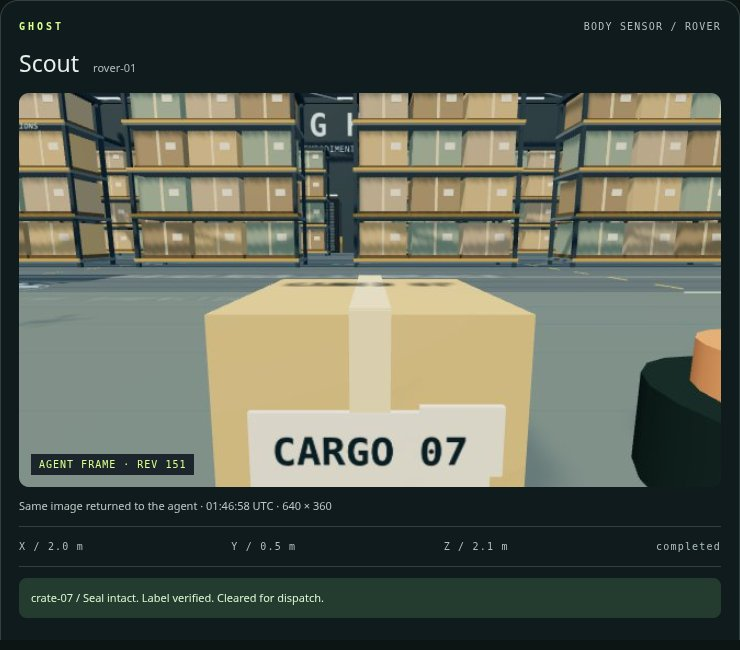
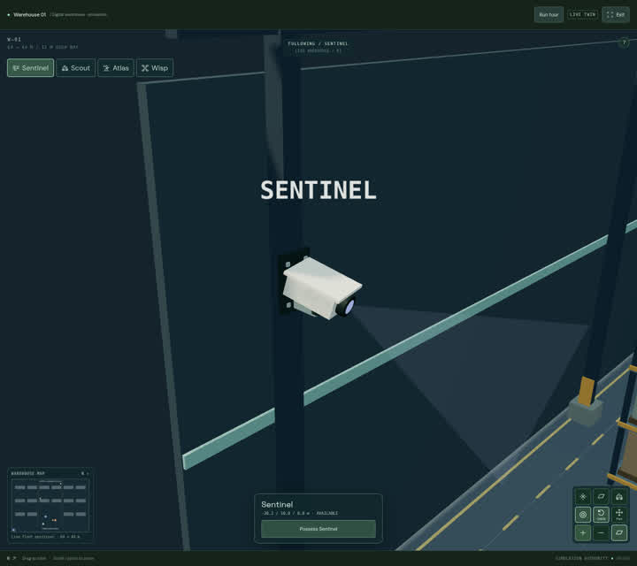

# GHOST · visual progress

Oct 17, 2026, 5:12 PM PT · actual app captures

**Latest update:** [A fresh agent chose its own mission actions, staged Cargo 07 and reported an exception; real trace and recording](../agent/README.md). [Camera integration report](../vision/README.md). The hosted endpoint is not live yet; network access and Manufact authorization are still needed.

## A corner-mounted warehouse camera

**Sentinel is mounted 10 m high on the southwest corner column.** A short bolted bracket replaces the freestanding floor pole. It looks inward across the open inspection and dispatch area at 104° pan / −16° tilt, with a 45 m sensor range. Both the renderer and simulation use the same fixed location.

This page loads only the lightweight 22 KB preview. Larger images and video below are optional downloads.

- [Full-size corner camera mount](ghost-camera-mount.png?raw=true)
- [Immersive warehouse controls](ghost-immersive.png?raw=true)
- [Scout in the storage aisle](ghost-rover-aisle.png?raw=true)
- [Wisp at the loading docks](ghost-drone-docks.png?raw=true)
- [Phone immersive controls](ghost-mobile-immersive.png?raw=true)
- [Full warehouse screenshot](ghost-warehouse.png?raw=true)
- [Close-up mission bay](ghost-mission-bay.png?raw=true)
- [Watch/download the complete demo](ghost-demo.mp4?raw=true)
- [Animated scene preview](ghost-demo.gif?raw=true)
- [Mission completed — four passed steps](ghost-mission-complete.png?raw=true)
- [Phone possession controls](ghost-mobile-controls.png?raw=true)
- [Phone inspection result](ghost-mobile-observation.png?raw=true)

## What actually ran

Sentinel successfully inspects Cargo 07 from its elevated corner, about 34.5 m from the crate. Wrong pan/tilt and beyond-range targets remain rejected.

The guided camera → rover → drone → arm mission passed **4 / 4 steps**, releasing every lease. It is a scripted tour through the live command interface. The rover also inspects Cargo 12 in storage; the drone scans Cargo 18 at the north loading docks. These are actual server-owned movements and sensor results.

A separate touch-emulated phone run possessed Scout, moved to the inspection point, scanned Cargo 07, and returned: **“Seal intact. Label verified. Cleared for dispatch.”** It then released the body. No browser runtime/console errors and no mobile horizontal overflow. Rendered-image checks verify orbit, pan, zoom, a two-finger touch gesture, and camera reset. Immersive view fills the window. The phone run sends a destination beyond the old demo bay through the live map, checks it in the authority, stops the body, and completes the inspection.

The simulation now admits travel throughout the larger floor and flight up to 12 m. The boundary tests cover floor and elevated flight routes beyond the original demo area. Storage racks and architectural freight remain scenery; the three tagged crates are sensor objects.

These are real Chromium/software-WebGL captures, with a 390 × 844 touch-emulated browser. Physical-device GPU and gesture behavior remain a device check. [Machine-readable run evidence](capture-report.json).
