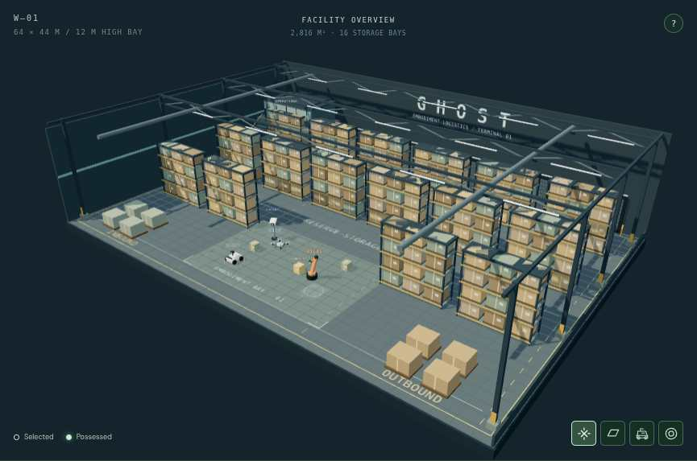

# GHOST · visual progress

Oct 17, 2026, 4:18 PM PT · actual app captures

## A much larger warehouse

**64 × 44 m · 2,816 m² · 12 m clear height.** About ten times the previous floor area, with 16 four-tier storage bays, six loading docks, high roof trusses, industrial lighting, and a mezzanine control room.

This page loads only the lightweight 40 KB preview. Larger images and video below are optional downloads.

- [Full warehouse screenshot](ghost-warehouse.png?raw=true)
- [Close-up mission bay](ghost-mission-bay.png?raw=true)
- [Watch/download the complete demo](ghost-demo.mp4?raw=true)
- [Animated scene preview](ghost-demo.gif?raw=true)
- [Mission completed — four passed steps](ghost-mission-complete.png?raw=true)
- [Phone possession controls](ghost-mobile-controls.png?raw=true)
- [Phone inspection result](ghost-mobile-observation.png?raw=true)

## What actually ran

The guided camera → rover → drone → arm mission passed **4 / 4 steps**, releasing every lease. It is a scripted tour through the live command interface. The camera moves from the facility overview into the embodiment bay so each body remains visible.

A separate touch-emulated phone run possessed Scout, moved to the inspection point, scanned Cargo 07, and returned: **“Seal intact. Label verified. Cleared for dispatch.”** It then released the body. No browser runtime/console errors and no mobile horizontal overflow.

The simulation now admits travel throughout the larger floor and flight up to 12 m. The boundary tests cover floor and elevated flight routes beyond the original demo area. Storage racks and architectural freight remain scenery; the three tagged crates are sensor objects.

These are real Chromium/software-WebGL captures, with a 390 × 844 touch-emulated browser. Physical-device GPU behavior and pinch gestures remain a device check. [Machine-readable run evidence](capture-report.json).
