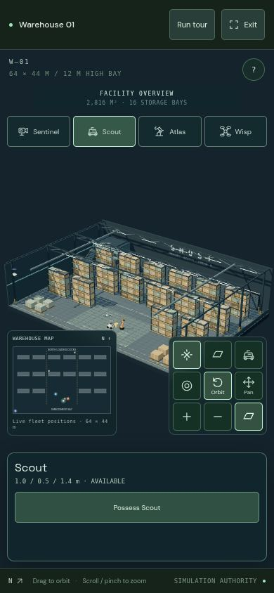

# GHOST · Manufact preparation

2026-10-18T00:50:27.331Z · real mobile-emulated Chromium captures

**Prepared and tested locally; the Manufact deployment is not live yet.** The cloud environment currently blocks Manufact's API, and a Manufact account still needs to be authorized. No hosted URL has been created.

Only the small phone preview loads above. Optional screenshots:

- [Private entry screen](ghost-private-login.jpg?raw=true)
- [Agent connection dialog](ghost-private-connect.jpg?raw=true) — the shown loopback URL belongs to this local test, not a public deployment
- [Machine-readable checks](access-report.json)
- [Earlier full warehouse tour and video](../latest/README.md)

## What ran

A real MCP client authenticated with a temporary private key, listed all five tools, possessed Scout, drove to the inspection point, inspected Cargo 07, and released the rover. Result: **“Seal intact. Label verified. Cleared for dispatch.”** The phone console rendered the same server-owned warehouse. Login, immersive controls, correct connection URL, and logout passed; the revoked browser cookie could no longer read a snapshot. No page errors or mobile horizontal overflow.

The production container also started with development dependencies removed. Its private entry screen, anonymous-request rejection, MCP initialization, five-tool listing, shared rover possession and release passed.

The camera checks exposed a portrait-view issue: pulling back to fit the larger hall pushed it into the old fixed fog distance. The viewing range and fog now follow the camera distance, so the warehouse stays visible in the phone's facility overview.

The complete scripted camera → rover → drone → arm tour still passed **4 / 4 mission steps**. This remains a simulation and a scripted tour; an external MCP agent supplies real reasoning. Authentication is a shared demo key. Header-capable clients can connect; ChatGPT's OAuth connector flow is not implemented.

The deployment uses mcp-use and targets one Node container on Manufact, preserving one shared in-memory world. Going live still requires network access, Manufact login, GitHub App repository access, runtime secret configuration, and verification that only one replica runs. See [deployment configuration](../../manufact-deployment.md).

**New:** [All four body camera views, actual MCP image observations, and an embedded mcp-use MCP App](../vision/README.md). The local test host and container are verified; hosted ChatGPT OAuth is still outstanding.
