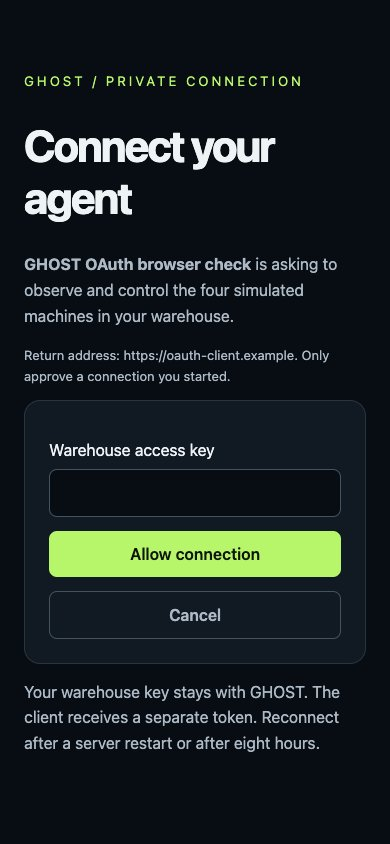

# GHOST · OAuth connection

Captured from the running app in mobile-emulated Chrome. The official MCP SDK completed discovery, confidential client registration, S256 PKCE, browser consent, cross-origin callback, authenticated MCP discovery, refresh rotation and revocation. The callback was intercepted locally; this is not a signed-in ChatGPT session. [Machine-readable report](oauth-report.json).

The browser check exposed and fixed an Origin/referrer-policy interaction that the HTTP-only tests did not catch. Server tests also cover invalid redirects, scopes and resources, wrong keys, CSRF/cookie checks, code replay, token expiry, cross-client isolation, refresh replay, encrypted registration integrity and key rotation.

The warehouse key remains on GHOST. Connectors receive separate tokens for the five MCP tools. Reconnect after eight hours or a server restart. [Deployment and connection instructions](../../manufact-deployment.md).
