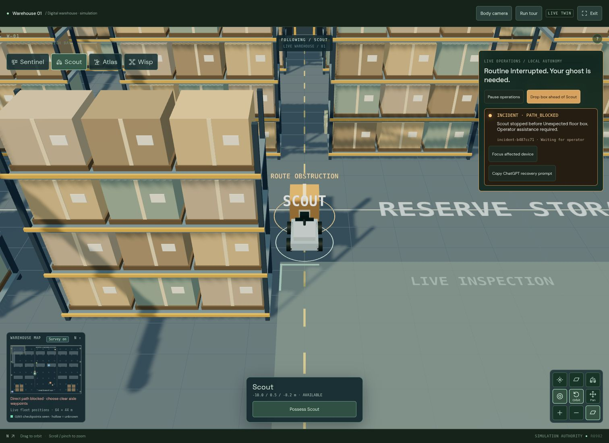
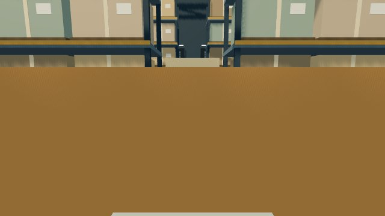

# GHOST · an operating warehouse, a ghost on call

October 18, 2026 · Real browser and official MCP SDK rehearsal. The operator calls in this recording are scripted QA, not a recorded ChatGPT conversation.

[Continuous incident → recovery → sandbox recording, 2×](incident-to-experiment-2x.mp4?raw=true) · [Working fleet](working-warehouse.jpg) · [Phone](working-mobile.jpg)

The warehouse runs local jobs continuously: rover aisle inspections, drone inventory sweeps, camera surveillance, and a one-shot arm dispatch assignment. Runtime box placement is authoritative. Swept collision checks stop a moving rover before contact and raise a detected incident while the other jobs continue.

The rehearsal then uses real MCP possession and a body-mounted JPEG, removes the simulated obstruction with a capability-authorized operator action, drives the rover forward, verifies the route and returns control to the local controller. Scout subsequently inspects Cargo 12. The incident remains in history.

[Operator possession](operator-possessed.jpg) · [Actual operator sensor JPEG](operator-sensor.jpg) · [Work resumed](operations-restored.jpg) · [Assertions and redacted MCP results](verification.json)

The same recording continues into an isolated warehouse comparison: the standard drone is blocked at the gap, and the compact candidate completes the workflow. Live operations keep running independently.

[Sandbox comparison](sandbox-comparison.jpg) · [Full continuous demo/operator recipe](../../live-operations.md)

For the presentation, place the box in the UI and manually tell ChatGPT: “There seems to be an incident in the warehouse. Investigate it and get operations moving again.” Refresh the connector to expose all 17 tools. No unsolicited ChatGPT wake-up is required.

Local autonomy is a deterministic task controller issuing real simulation commands. External ChatGPT supplies reasoning. Box removal is a simulated operator action; the rover has no gripper. Motion remains kinematic, with no real hardware or dynamic device collisions. State is in memory.

[Earlier experiment evidence](../experiments/README.md) · [Rack geometry](../racks/README.md) · [Navigation and independent agent evidence](../navigation/README.md)
