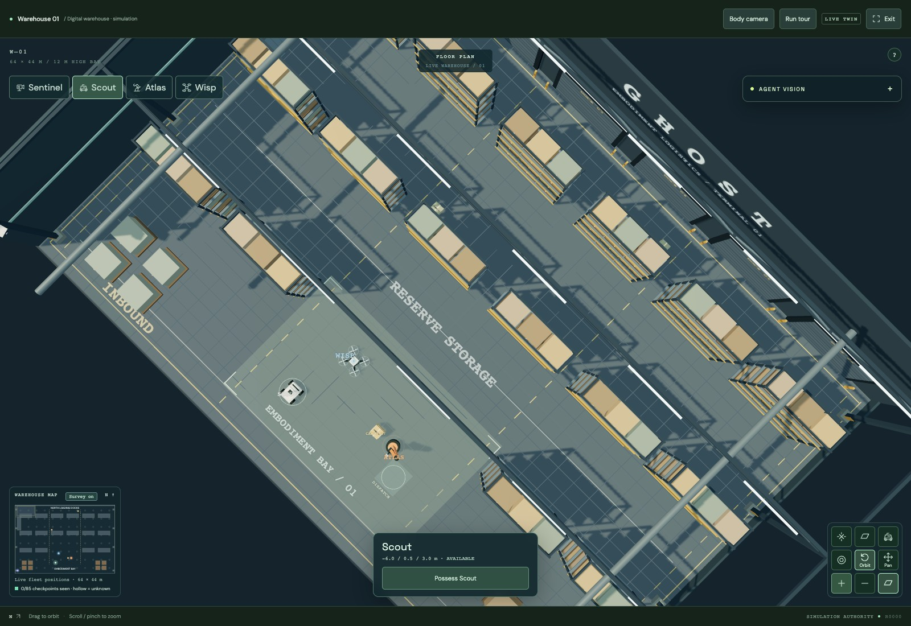

# Rack top rendering

The fourth storage tier remains in place. Its boxes and the former solid rack cap both ended at y=8.05, causing striped patches as their overlapping top faces competed in the depth buffer. The cap is now four perimeter rails outside the stock footprint, within the existing collision envelope.

Actual Chromium/WebGL captures from the local production build, using the same camera actions before and after the change:

[Before the geometry fix](before-angled.jpg). Both fixed views rendered without browser errors. Type checks, production builds, and the repository test suite validate the change; hosted deployment is verified separately.
