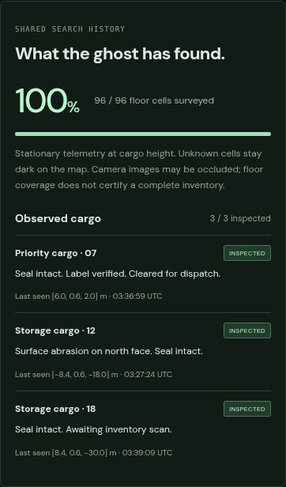

# GHOST · search history meets a fresh agent

2026-10-18T03:25:56.176Z · actual independent Codex agent run

**3/3 tagged crates inspected; priority dispatch verified.** The agent recorded 96/96 floor cells (100%) through stationary analytic observations. Post-run authority checks confirmed all tagged cargo was inspected. This does not certify exhaustive visual or elevated-rack coverage.

Only this 30 KB preview loads automatically. [24-second edited highlights — 119 KB](agent-highlights.mp4?raw=true). Three chronological excerpts from the actual recording; gaps are omitted. [Watch the full actual run at 4× speed — 230 seconds, 1507 KB](agent-mission-4x.mp4?raw=true).

- [Actual survey map](survey-map.jpg?raw=true)
- [Final warehouse console](final-console.jpg?raw=true)
- [An actual sensor image viewed by the agent](frames/sensor-003-camera-01.jpg?raw=true)
- [Original redacted MCP trace](trace.json)
- [Fresh-context prompt, image-viewing attestation and final report](agent-attestation.json)
- [Post-run authority verification](verification.json)
- [Separate post-control mobile check](review-survey-mobile.jpg?raw=true) · [capture provenance](review.json)
- [Highlights cut list](highlights.json)

## What changed

Discovery now exposes analytic telemetry ranges, inspection distances, camera view/aim bounds, drone flight limits and arm gripper preset positions. A shared 12 × 8 survey grid records fully observed floor cells, and a cargo ledger retains actual observations and successful inspections across body switches. Unknown cargo IDs and a ground-truth inventory count are never supplied by discovery. Agents still choose their own bodies, search positions and actions.

A cell is credited only by a stationary observation whose analytic footprint covers its whole floor area at Y 0.55 m. Moving polls do not credit swept paths. History is shared across clients, is historical rather than a current occupancy guarantee, and clears on reset/restart. Images have scene occlusion; analytic telemetry does not. A survey finding is separate from an inspection, and inspection text does not imply visible damage textures.

## The independent run

The agent started with no inherited chat or repository context. It was given a general mission, the actual MCP schemas and recorder transport instructions. No cargo locations, IDs, expected findings, route or body sequence were supplied. It was instructed to avoid source/docs, spectator DOM and snapshot APIs. This was instruction-bound, not a restricted-filesystem benchmark.

The agent inspected three tagged crates: Cargo 07 cleared for dispatch; Cargo 12 surface abrasion on north face with intact seal; Cargo 18 intact seal awaiting inventory scan. It staged Cargo 07 at [6,0.55,2], viewed the arm placement image and independently verified the position through drone telemetry. It completed 96/96 analytic floor cells, while explicitly declining to certify elevated or occluded inventory. The arm was home and empty, the drone landed at [2.583,0.4,-18], and all leases were released. It used camera images, sensor limits and unknown floor cells to choose its route, including changing approaches after rack-face images. It made 90 recorded MCP calls excluding 50 aggregated movement waits. No MCP errors, unavailable images or final export errors occurred.

Control lasted about 13 minutes 44 seconds; the full session also includes the requested post-control spectator pause and export. There were 90 recorded MCP calls, excluding aggregated motion polls. The agent directly viewed 18 sensor images. No image deliveries were reported unavailable. The trace preserves 0 MCP tool errors and 0 recorder presentation errors, plus 0 recorder command errors. Export status: completed. Cleanup checks: leases released, arm home and empty, drone landed.

This run had a 100-call budget, compared with 60 in the [initial run](../agent/README.md), and its objective explicitly requested systematic search using observation history. They are two real examples, not a controlled performance comparison. The deterministic all-cell unit test is a separate scripted correctness check and is not presented as agent behavior.

The recorder forwards externally chosen MCP commands and saves exact sensor images plus continuous browser capture. It contains no model, mission planner or route. Mobile/ledger/map stills were captured after the mission and were not supplied to the agent. The mobile preview uses the final contrast correction; the continuous recording preserves the UI as it ran. Manufact hosting, ChatGPT OAuth, physical collision avoidance and a guaranteed exhaustive inventory planner remain outside this result.
